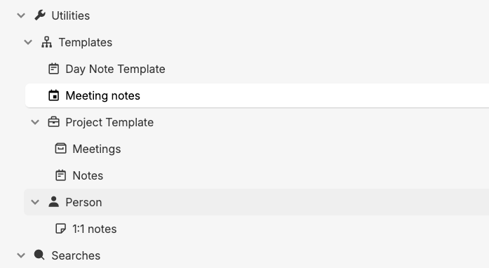
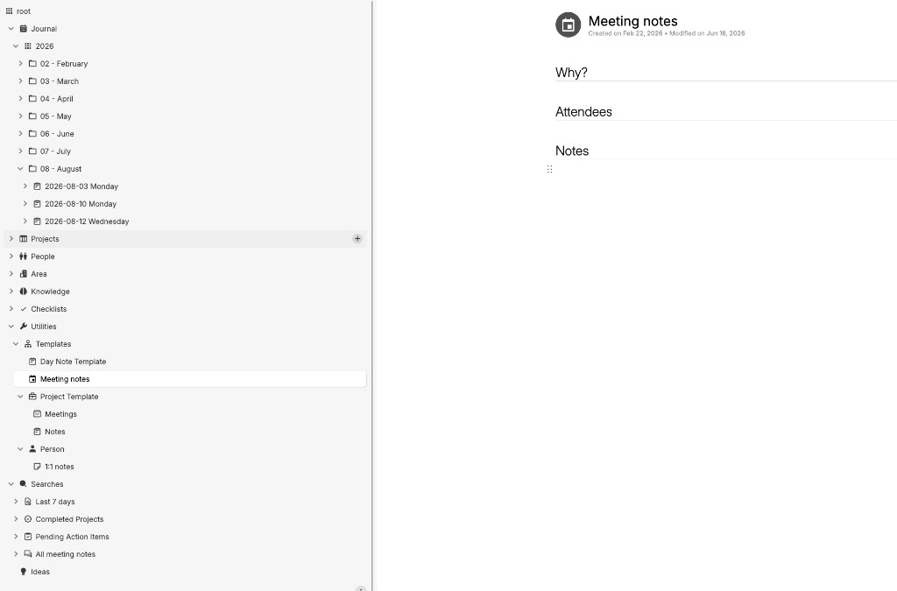
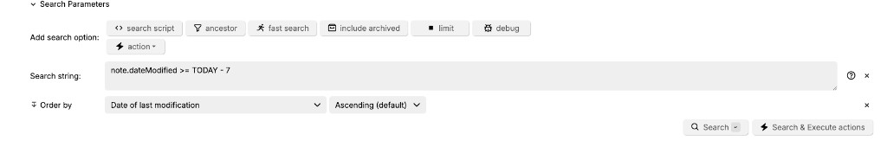

Most note systems make you pick one home for a note at capture time. Journal or project folder. Daily log or people record. You either file it correctly while the thought is still warm, or you dump it somewhere generic and never find it again.

I use [Trilium Notes](https://github.com/zadam/trilium) because it lets me avoid that choice. I capture in the daily journal (when something happened) and file by context (which project, which person, which domain) without copying text between places. [Cloned notes](https://docs.triliumnotes.org/user-guide/concepts/notes/cloning) are the mechanism: the same note appears in multiple locations in the tree, shares one body of content, and edits in any clone update everywhere.

This post is about that organizational layer. For the capture protocol I use during meetings (D/A/Q/B tags, three tiers of raw capture, cleanup, and promotion), see [D/A/Q/B: a live-capture protocol for meeting notes](/how-to-take-meeting-notes). That post covers *what* to write down while something is happening. This one covers *where* notes live afterward.

## The sidebar structure

Under the root of my Trilium tree, nine top-level sections. Each has a job.

**Journal** is the temporal spine. Daily notes sit under year, then month, then date: `Journal > 2026 > 08 - August > 2026-08-12 Wednesday`. Anything I capture on a given day starts here. A note called "SDK rollout" nested under a daily entry is work captured in the context of that day, not yet filed anywhere else.

**Projects** holds project-specific notes: thinking notes, meeting notes, status updates. Some of these also appear under the daily journal entry for the day I created them. That duplication is intentional, and it's handled by clones, not copy-paste.

**People** holds people-related notes: roles, strengths, 1:1 notes. When a meeting note gets promoted to a People record (as described in the D/A/Q/B post), it lands here.

**Area** holds long-lived notes scoped to domains of responsibility. Debugging tips for a specific service, runbooks for a system I own, operational knowledge tied to a role rather than a single project.

**Knowledge** holds long-lived notes at industry or general level. Information that applies across contexts, not tied to one service or one project.

**Checklists** holds checklists for various things. Some are clones pulled from a specific project.

**Utilities** holds templates and other custom setup I built for Trilium. More on that below.

**Searches** holds saved search queries that act as dynamic views: last 7 days, completed projects, pending action items, all meeting notes.

**Ideas** is the lightbulb bucket in the sidebar. The point is zero-friction capture of any fleeting idea that isn't ready to be filed yet.

The shape is [PARA-adjacent](https://fortelabs.com/blog/para/): Projects, Area (I use the singular), Knowledge (similar to Forte's Resources). Journal adds a temporal layer that PARA doesn't emphasize. The workflow still maps to Forte's [CODE framework](https://fortelabs.com/blog/basboverview/) (Capture, Organize, Distill, Express), which the meeting notes post already connects to capture and promotion. Here, Organize is the focus.

## Journal as capture surface

During the day, I don't decide where a note belongs permanently. I create it under today's journal entry. Meeting notes, work log fragments, quick observations: all of them start in the daily note for the date they happened.

This matches the just-in-time organizing idea from the meeting notes post: [don't file everything upfront in case it's needed later](https://fortelabs.com/blog/just-in-time-pm-12-just-in-case-to-just-in-time/). Capture first, in time. Organize later, when you know the note has lasting value.

Most notes stay in the journal and decay there. That's fine. The journal is also a readable record of what I was doing on any given day, which is useful on its own even when nothing gets promoted.

## Templates in Utilities

Capture speed depends on how fast you can open a blank note with the right shape already in place. Trilium's [template notes](https://docs.triliumnotes.org/user-guide/advanced-usage/template) are how I do it. Under **Utilities > Templates**, I keep a small set of note types I create often:



- **Day Note Template** for daily journal entries
- **Meeting notes** for live capture during meetings
- **Project Template**, with sub-notes for Meetings and Notes
- **Person**, with a sub-note for 1:1 notes

When I need a new meeting note, I clone the Meeting notes template into today's journal entry (or directly into a project). The structure is already there. I don't spend the first thirty seconds of a meeting formatting headings.

The meeting notes template itself is intentionally minimal:



Three sections: **Why?** (purpose of the meeting), **Attendees**, and **Notes** (where D/A/Q/B capture happens during the live meeting). The D/A/Q/B protocol from the [meeting notes post](/how-to-take-meeting-notes) fills in the Notes section. The template handles the scaffolding; the protocol handles what gets written.

Project and Person templates work the same way: clone the template, get a pre-structured note in the right place, start writing. The Project Template gives you Meetings and Notes sub-notes out of the box. The Person template gives you a 1:1 notes sub-note. These aren't elaborate. They're just enough structure that every note of the same type starts with the same headings, which makes searching and skimming easier later.

## Clones: capture in time, file by context

The insight that makes this work: I don't have to choose between "when" and "where."

When a meeting note earns promotion to a project, I clone it. The clone appears under the project tree. The original stays under the journal entry for the day the meeting happened. Same content, two locations. Edit the summary in one place, both update.

Example: I capture a meeting under `2026-08-12 Wednesday` during tier-one raw capture. After cleanup, I clone it to the relevant project. Now I can find it by date ("what happened that Wednesday?") or by project ("all notes for this rollout"). I didn't copy anything. I didn't maintain two versions.

Trilium's [cloning documentation](https://docs.triliumnotes.org/user-guide/concepts/notes/cloning) describes this precisely: clones share content. The tree is a view, not a container. That distinction matters. In most note apps, moving a note removes it from the old location. In Trilium, cloning adds a second pointer without removing the first.

Checklists work the same way. A release checklist might live under a project, then get cloned into the Checklists section for reuse across releases.

## Area vs Knowledge

These two get confused because both hold long-lived reference material. The distinction I use:

**Area** is scoped to a domain of responsibility I currently own or actively maintain. Debugging tips for a specific internal service. How to rotate credentials for a system on my team. Operational runbooks. If I changed roles and stopped owning that service, the note might get archived or moved.

**Knowledge** is general and portable. A pattern for handling idempotency in distributed systems. Notes on how a public API behaves. Industry-level concepts that apply regardless of which project or employer I'm at.

The test I apply: would this note still be useful if I switched teams tomorrow? If yes, Knowledge. If it's tied to a specific system I operate, Area.

## Searches as the retrieval layer

I don't maintain perfect folder hygiene. Saved searches replace that.

**Last 7 days** gives me recent activity without drilling into the journal tree. The saved search uses a simple date filter (see [Trilium search syntax](https://docs.triliumnotes.org/user-guide/concepts/navigation/search)):

```
note.dateModified >= TODAY - 7
```

That matches what I use in my setup; the screenshot shows spaces around the operators. Results sort by date of last modification, ascending. Anything I touched in the past week surfaces in one view, regardless of which folder or journal entry it lives under.



**Pending action items** surfaces action items from meeting notes that still need follow-up.

**All meeting notes** is a single view across projects and journal entries.

**Completed projects** helps me find finished work without manually moving notes to an archive.

These are dynamic views, not folders I have to keep current. A note stays wherever it was captured and cloned. The search query finds it when I need it. This is the action layer on top of the organizational architecture: I don't browse the tree to find what needs doing. I open a saved search.

## Ideas: frictionless fleeting capture

Not every thought deserves a journal entry or a project folder. The Ideas section exists for thoughts that arrive mid-debugging, mid-walk, mid-conversation: half-formed, unscoped, not ready to file.

I capture the idea there and move on. Later, during promotion (tier three in the meeting notes workflow), some ideas get cloned to a project, expanded into a Knowledge note, or deleted because they didn't hold up. Most ideas do nothing, and that's the point. The bucket lowers the cost of capture. Without it, I'd either lose the thought or interrupt my current task to decide where it belongs.

## How the pieces connect

The full flow, end to end:

1. **Capture** in today's journal entry (or Ideas, for unscoped thoughts).
2. **Tag and cleanup** using D/A/Q/B during and after meetings (see the [meeting notes post](/how-to-take-meeting-notes)).
3. **Promote** by cloning to Project, People, Area, or Knowledge when the note earns a permanent home.
4. **Retrieve** through saved searches when I need pending actions, recent work, or all meeting notes.

Journal answers "when." Projects, People, Area, and Knowledge answer "what context." Clones connect the two without duplication. Searches answer "what needs attention now."

## Honest limitations

This is personal practice, not validated research. I haven't measured whether this system makes me more productive, and I'm not going to claim it will work for everyone. Trilium has a learning curve. Clones are powerful but easy to misuse: clone too aggressively and your tree gets noisy; clone too rarely and you lose the cross-context linking that makes the system worth the setup.

The Utilities section is customized to my setup. Your Trilium instance won't look exactly like mine without building similar templates and searches. That's expected. The methodology transfers; the specific folder names and saved queries are mine.

Trilium is also self-hosted software you maintain yourself. If you want a managed service with similar ideas, other tools exist. I use Trilium because hierarchical notes plus clones plus saved searches fit how I think. Your constraints may differ.

## How to start

If you already use Trilium, start small:

1. Create a **Journal** tree with year/month/date nesting. For one week, capture everything there, nothing elsewhere.
2. Build one **template** under Utilities (a meeting note or daily note is enough). Clone it whenever you need a new note of that type.
3. Pick one active project. When a journal note clearly belongs to it, **clone** it to the project. Notice that both locations stay in sync.
4. Create one **saved search** for something you look up repeatedly (recent notes, meeting notes, action items). Use the search instead of reorganizing folders.
5. Add an **Ideas** bucket. Capture one fleeting thought there without deciding where it goes.

If you're also adopting D/A/Q/B for meetings, read the [meeting notes post](/how-to-take-meeting-notes) first. The capture protocol and the organizational architecture are separate layers, and both matter. Capture without organization leaves notes scattered. Organization without capture leaves nothing worth organizing.

Most notes will stay in the journal and never get cloned. That's by design. The ones that matter will be findable by date, by project, and by search when you need them.
